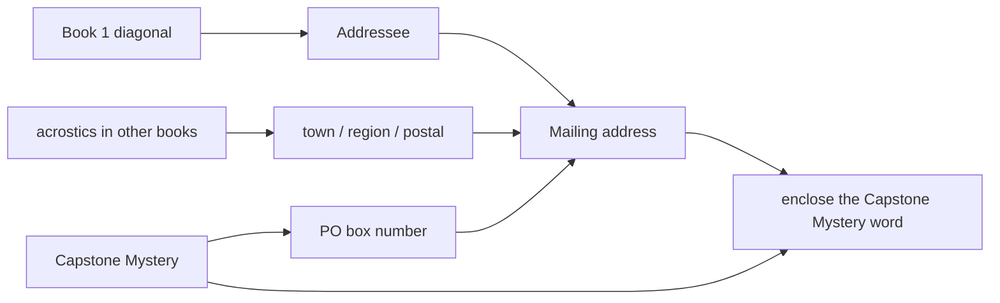
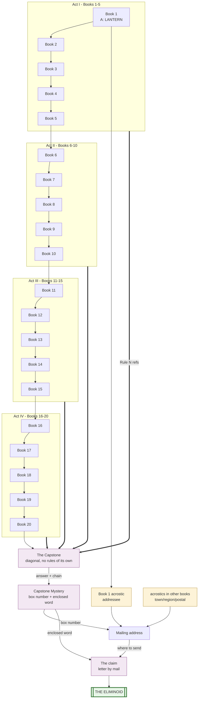

# Eliminoid series map

The plan for the whole series, written plainly. Anything marked [prov]
is a specific proposal the engine must still validate and that may be
swapped for taste — specific enough to work from, not yet final.

## What these books are

Each Eliminoid book is a book of word grids. You work through numbered
rules, crossing out words, and exactly one word in the whole book
survives everything. That's the answer; you write it in a box at the
back. Any book can be bought and solved on its own, in any order.

On top of that, a quest runs through the whole series. At its end, one
person wins the Eliminoid: a one-of-a-kind ceramic artwork I will
make. The books say all of this plainly, and make two promises:
nothing is hidden without a printed instruction somewhere that points
to it, and the whole quest can be done with the books alone.

The quest runs on a few simple ideas: dead words stay readable (cross
out with a thin line or highlighter, never obliterate); every word has
an address (page, row, column); each book from Book 2 on has a MYSTERY
WORD found via printed instructions, usually look-ups into earlier
books; each book has an ANSWER box on its own page and a MYSTERY box
on its own page, the two pages of honour in the back. Nothing is
gathered in a central ledger — each value lives in the book it came
from, and everything finally comes together only at the Capstone.
Beside both the Answer and the Mystery, the book prints a HASH of the
right word — the kind of fingerprint used to check a file download.
You cannot read the word out of a hash, but you can check a word
against it: type your word on eliminoid.com and it tells you whether
it matches. Solving never needs the website; the check is just there
when you want to be sure before moving on, so nobody chases a wrong
word through the rest of the series.

## Hiding things well (the camouflage laws)

A hidden thing must be invisible to someone without the instruction
and unmistakable to someone with it. The laws we work by:

1. Never plant message words in adjacent cells. A readable phrase
   sitting in a row jumps out of a field of unconnectable words.
   Scatter instead: initials down a column or diagonal, every-Nth
   positions, single words at far-apart addresses.
2. Prefer initials. A column of words like GRANITE, LENTIL, OTTER
   reads as nothing; its first letters can spell anything. Initials
   are the workhorse of hidden text.
3. Search bounds are a difficulty knob, not a requirement. An
   instruction may name a page range to make a hunt quick, or leave
   the whole book as the haystack when the hunt itself is meant to be
   work (Ian: "it's OK for the player to look through 100 pages of
   words"). What it must always do is name the BOOK — the search
   space is stated even when it is large. Exact addresses need no
   bounds.
4. Plants are cast to type. A word meant to be found later should look
   like any other grid word — commonish, unremarkable. No plant may be
   the strangest word on its page.
5. No artificial waiting. If a payoff is deferred to a later book, that
   book must be a necessary ingredient of the payoff — part of the
   path, not just the envelope the instruction arrives in. A reader
   should never be able to say "you could have told me this earlier."
6. Every revelation bears on the outcome. A hidden thing, once found,
   must be an INPUT to something downstream — never just a tease, a
   warning, or a description. If removing a revelation changes nothing
   about reaching the final word you mail, the revelation is decoration and
   must be redesigned or cut.
7. Hidden content must be self-sufficient. A hidden message must be
   complete and clear on its own, actionable with no supplemental
   explanation. The failure mode is a hidden thing the revealer must
   then paraphrase (then why was it hidden?).
   Pointers locate; they never restate.
8. Every Mystery must matter. The chain sees to this on its own: each
   Mystery is the row-and-column input to the next one, so a single
   wrong Mystery breaks every Mystery after it, all the way to the
   Capstone. No Mystery is ever decoration.
9. A Mystery depends only on earlier books. Book N's Mystery uses Book
   N itself and the books before it, never a later one — so any book
   is solvable the moment you own it and the ones under it. The
   Mysteries form a chain: each grows from the previous book's
   Mystery, back to Book 1's, which is derived from Book 1 alone.

## Shape of the series

Twenty books, then the Capstone, which is Book 21. The Capstone is a
simple diagonal: Rule 1 from Book 1, Rule 2 from Book 2, on through
Rule 20 from Book 20 — so the whole shelf is its rulebook.

Every book is built the same way: a page of rules, a body of 100 pages
laid out 25 rows by 5 columns, an ANSWER box and a MYSTERY box in the
back (each on its own page, each with a hash you can check on the website),
and a page of hints counting how many words each rule crosses out
(fenced by "SPOILER ALERT" pages so no one meets it by accident). A
few books also hide a short acrostic, which stays dormant until the
Capstone points to it. That is the whole kit; nothing else to track.

---

## How every Mystery is found

LOCKED FORMULA — do not change without a new agreement (Ian, 2026-10-23).

Book 1 (the root) derives its Mystery from its own answer. Books 2-21
BLEND the positions of two words. Both are read IN THE SAME BOOK.

Books 2-21:

  "1. Find your answer for this book — the one word still standing.
      Note its page, row, and column.
   2. Find your Mystery Word from the book before, here in this book.
      Note its page, row, and column.
   3. Add them: the two pages (subtract 100 if over 100); the two rows
      (subtract 25 if over 25); the two columns (subtract 5 if over 5).
   4. The word at that page, row, and column in THIS book is your
      Mystery Word."

Book 1 (no previous Mystery):

  "Turn your answer's letters into numbers (A=1, B=2...) and add them
   up — that is the page. The answer's letter count is the row; its
   vowel count is the column. The word there is your Mystery Word."

Why the blend (the point, for us — never printed): adding an
unknown-but-uniform position is a one-time pad. With only ONE of the
two words you can compute nothing — the Mystery stays 1 in 12,500 (the
whole book), the best possible. You need THIS book's answer (you solved
it) AND the previous Mystery (you walked the chain). So holding Book N's
Mystery proves books 1..N were solved; the Capstone's proves all 21
(law 9). Each answer and each Mystery is planted at a uniformly-random
cell, so the pad is uniform.

```pseudocode
POS(book, word)  = { the word's cell in that book: {page, row, column} }
LOOKUP(book, pos)= { the word printed at pos }
CHECKSUM(word)   = { add letter scores A=1, B=2, ...; return the total }
LENGTH(word)     = { number of letters }
VOWELCOUNT(word) = { number of vowels (A E I O U) }
// wrap: pages 1..100, rows 1..25, columns 1..5

// Every book N >= 2, read IN book N:
a = POS(book[N], Answer[N]);        // you solved this book
m = POS(book[N], Mystery[N-1]);     // you walked the chain
Mystery[N] = LOOKUP( book[N], {
  page:   wrap(a.page   + m.page,   100),
  row:    wrap(a.row    + m.row,    25),
  column: wrap(a.column + m.column, 5)
} );

// Book 1 (the root), read IN book 1:
Mystery[1] = LOOKUP( book[1], {
  page:   CHECKSUM(Answer[1]),   // letter-sum, A=1..Z=26
  row:    LENGTH(Answer[1]),     // number of letters
  column: VOWELCOUNT(Answer[1])  // number of vowels
} );
```

The Mysteries are deliberately plain. The only other hidden content is
a handful of acrostics (see "Hidden in the books"), pointed at nowhere
until the Capstone.

## Book by book

### Books 1-5

**Book 1.** The root of the chain. It has no book before and no
previous Mystery, so it derives its Mystery from its own answer:

  "Turn your answer's letters into numbers (A=1, B=2...) and add them
  up — that is a page. The answer's letter count is the row; its vowel
  count is the column. The word at that page, row, and column is your
  Mystery Word."

[prov] With the answer LANTERN: letter-sum 84, seven letters, two
vowels — page 84, row 7, column 2, holding [prov] CINDER. Every later
Mystery grows out of this one.

Book 1 also carries two things the reader never notices while solving
it:

- A hidden acrostic on page 12: read one word per row, stepping one
  column right each row and wrapping back to the left at the edge; the
  25 first letters spell TO THE KEEPER OF THE ELIMINOID. A staircase,
  not a column, so it is far harder to spot. No box, no instruction —
  it stays dormant until the Capstone tells the reader to read it. It
  is the addressee line of the mailing address.
- The Capstone's Mystery word, planted on one page: the page number
  it sits on is the PO box number. No box, no instruction — dormant
  until the Capstone tells the reader to find it.

**Book 2.** The standard procedure begins (see "How every Mystery is
found"): find your Book 2 answer and Book 1's Mystery, both here in
Book 2; add their positions (page+page, row+row, column+column, each
wrapped); the word at that spot in Book 2 is the Mystery. [prov]
Mystery: VESSEL. Book 2 teaches the procedure plainly, since every
later book repeats it.

**Book 3.** Same procedure, now using Book 3's answer and Book 2's
Mystery. [prov] Mystery: TBD. By the third book the chain feels like a
chain — each new Mystery needs the last.

**Book 4.** Standard procedure (points at Book 3). [prov] Mystery:
TBD.

**Book 5.** Standard procedure (points at Book 4). [prov] Mystery:
TBD.

### Books 6-10

**Book 6.** Standard procedure (points at Book 5). [prov] Mystery:
TBD.

**Book 7.** Standard procedure (points at Book 6). [prov] Mystery:
TBD.

**Book 8.** Standard procedure (points at Book 7). [prov] Mystery:
TBD.

**Book 9.** Standard procedure (points at Book 8). [prov] Mystery:
TBD.

**Book 10.** Standard procedure (points at Book 9). [prov] Mystery:
TBD.

### Books 11-15

**Book 11.** Standard procedure (points at Book 10). [prov] Mystery:
TBD.

**Book 12.** Standard procedure (points at Book 11). [prov] Mystery:
TBD.

**Book 13.** Standard procedure (points at Book 12). [prov] Mystery:
TBD.

**Book 14.** Standard procedure (points at Book 13). [prov] Mystery:
TBD.

**Book 15.** Standard procedure (points at Book 14). [prov] Mystery:
TBD.

### Books 16-20

**Book 16.** Standard procedure (points at Book 15). [prov] Mystery:
TBD.

**Book 17.** Standard procedure (points at Book 16). [prov] Mystery:
TBD.

**Book 18.** Standard procedure (points at Book 17). [prov] Mystery:
TBD.

**Book 19.** Standard procedure (points at Book 18). [prov] Mystery:
TBD.

**Book 20.** Standard procedure (points at Book 19). [prov] Mystery:
TBD. A closing line points forward: "There is one more book — the
Capstone. It needs all the others, and it is the end."

## Hidden in the books: the address acrostics

The journey is uniform: every book has an Answer and a Mystery, and
nothing else the reader has to track. But a handful of books carry a
hidden ACROSTIC — a short message spelled by the first letters of a
diagonal or a column — planted in the grid and invisible the whole
time. Nothing in the journey points at them. Only at the very end does
the Capstone name each one and tell you to read it; together they give
the mailing address.

What the acrostics spell [all prov]:

- **Book 1** — the addressee: a 25-letter wrapping diagonal on page
  12 (one word per row, stepping one column right each row, wrapping
  at the edge) spelling TO THE KEEPER OF THE ELIMINOID.
- **Other books** — the town, the region, the country, and the
  letters of the postal code: each a short acrostic in some book,
  assigned at build.

The PO box number does not come from an acrostic — it comes from the
Capstone's own Mystery (see "The Capstone"), because that is the one
value no one can reach without finishing all twenty-one books.



Each acrostic is self-contained: once the Capstone tells you where to
look, reading it needs nothing else (law 7).

### The Capstone

The Capstone prints no elimination rules of its own. What it prints
is the diagonal (which rule to borrow from which book), its grid, the
two boxes, the section that turns your Mysteries into the mailing
address, and the directions for claiming the prize. Its cover says
plainly that it cannot be solved without the other twenty books.

The chain is the simple diagonal: the manifest's first
twenty lines just say "Rule 1 is Book 1's Rule 1. Rule 2 is Book 2's
Rule 2. ..." The shelf is the rulebook — reading each rule means
opening each book.

The Capstone is Book 21. It has its own Answer (the survivor of the
diagonal) and its own Mystery, found by the same rule as every other
book — so the Capstone's Mystery needs the Capstone's Answer (you
solved the diagonal) and Book 20's Mystery (you walked the whole
chain). That one word can only exist in the hands of someone who
finished all twenty-one books. It is the heart of the ending.

The Capstone also prints the ADDRESS-CONSTRUCTION section: how to turn
what you have collected into a mailing address. None of it is printed
plainly — every line is read from the books:

- The ADDRESSEE line comes from a 25-letter acrostic in Book 1: the
  wrapping diagonal on page 12, first letters, spelling TO THE KEEPER
  OF THE ELIMINOID. The Capstone names it.
- The PO BOX NUMBER comes from the Capstone's Mystery word — the one
  value no one can reach without finishing all twenty-one books. A PO
  box cannot be delivered to without its number, so this is the hard
  gate: no Capstone Mystery, no box number, no letter.
- The TOWN, REGION, and POSTAL CODE are read from acrostics hidden in
  earlier books. The Capstone names each one: "the town is the
  diagonal on page 30 of Book 4"; "the postal code's letters are the
  first letters down column 2 of page 40 of Book 9," and so on. These
  acrostics sit invisibly in those books the whole time; nothing in
  the journey points at them until the Capstone does.

You enclose one word in the letter: the Capstone's Mystery — your
proof you finished the series. Then you mail it. The address is a PO
box I open before the series is finished and keep for as long as the
quest runs; the books also print "or wherever eliminoid.com says to
write," in case a decade outlasts the box.

A correct letter isn't proof on its own, so I check the sender before
anyone wins. I don't ask for answers (those could be copied from a
leak) — I ask for words at spots I choose on the fly: "what is the
word on page 60, row 14, column 3 of Book 7?" Only someone holding
the physical books can answer that, and I can ask as many as I like.
The first sender who passes, by postmark, wins. Then the Eliminoid
goes to them in the mail, insured, packed by the person who made it.
I just send it.

The same day, I publish the document I wrote and locked before Book 1
ever went on sale — I'd posted its fingerprint back then so anyone
could check it hadn't changed. It shows the whole thing was planned
from the start.

```pseudocode
// Book 21's Mystery, by the same rule as every book -- proof of all 21:
a = POS(capstone, Answer[capstone]);   // solved the diagonal
m = POS(capstone, Mystery[20]);        // walked the whole chain
Mystery[capstone] = LOOKUP(capstone, {
  page:   wrap(a.page + m.page, 100),
  row:    wrap(a.row + m.row, 25),
  column: wrap(a.column + m.column, 5)
})

// The box number comes from the enclosed word by a FIND the Capstone
// prints -- no arithmetic. [prov]: the builder plants the word on the
// page equal to the rented box number, so finding it gives the box.
boxNumber    = POS(book[named by Capstone], Mystery[capstone]).page  // [prov]
enclosedWord = Mystery[capstone]                    // what you mail

// Other address lines: acrostics the Capstone names, in earlier books.
town    = SPELL(INITIALS(DIAGONAL(book4, page[30])))        // [prov]
postal  = SPELL(INITIALS(GET_WORDS(book9, page[40], column[2]))) // [prov]
// ...region, country similarly, each pointed at by the Capstone.

addressee = SPELL(INITIALS(DIAGONAL(book1, page[12])))  // TO THE KEEPER...
Address   = addressee
          + "P O BOX " + boxNumber
          + town + region + country + postal
```

You buy the Capstone like any other book. It sits on the shelf for
sale next to the rest. The only difference is its cover says plainly
that you can't solve it without the other twenty — same honesty as
everything else in the series.

---

## The connection graph

How everything feeds everything. Solid arrows: "this book's printed
grid is an ingredient." Dashed arrows: "this earlier found VALUE is an
ingredient." Renders on GitHub and in VS Code's Mermaid preview.



Reading the graph: the Mysteries form one straight chain through all
twenty-one books; the Capstone's Mystery (the chain's last link) gives
the PO box number and the word you enclose; the rest of the address is
read from acrostics hidden in earlier books. If an edge is missing
here, it is missing in the design.

## Builder notes

The technical section. Every plant is machine-validated at series
build; every secret must appear in the revealer ledger.

The Mystery chain (the backbone) — position-blend, read in this book:
- For every book N >= 2, Mystery[N] is read in book N at the cell got
  by ADDING (per coordinate, wrapping) the positions of THIS book's
  answer and the previous book's Mystery, both located in book N. Book
  1 is the root: no previous Mystery, so its cell comes from its own
  answer -- letter-sum = page, letter count = row, vowel count = column
  -- read in Book 1.
- Plants the chain needs, all in book N: the answer at its uniform
  (non-corner) cell; Mystery[N-1] planted at a uniform cell so the
  reader can find it; Mystery[N] planted at the blended cell. Every
  word in a book is unique, so finding the answer or the previous
  Mystery lands on exactly one cell.
- No page/row/column can land out of bounds: any answer's page is
  1..100 (valid in both books), and a found word's row/column are
  real grid positions by construction. Nothing to constrain by hand.
- Verification is separate from all of this: each Answer and Mystery
  prints a salted hash, checked on eliminoid.com. The hash never feeds
  the derivation.
- Security property (the point): the chain cannot be run from Book 1's
  Mystery alone. Each step needs that book's Answer, which needs
  solving that book. Knowing an early Mystery buys nothing without
  doing every book's puzzle.

Address acrostics (dormant plants, named by the Capstone):
- Book 1 p12: wrapping-diagonal acrostic (step +1 column per row, mod
  5) = TO THE KEEPER OF THE ELIMINOID, the addressee line.
- A few other books carry short acrostics for the town, region,
  country, and postal-code letters; the engine plants each so its
  initials spell the needed text. None is referenced until the
  Capstone names it.

Capstone (Book 21):
- The diagonal chain (Book N's Rule N for N=1..20), keep_fractions
  retuned by the Advisor to a buildable, verifiable chain; its
  survivor is Answer[capstone].
- Mystery[capstone] = the uniform rule applied to Book 21; it is the
  all-21 proof word. The PO box number comes from it by a FIND the
  Capstone prints (no arithmetic); it is also the word enclosed in the
  letter.
- The town/region/country/postal lines are acrostics planted in
  earlier books (dormant until the Capstone names them); the engine
  plants each so its initials spell the needed text.

Revealer ledger (no secret without its pointer):
- Book 1's Mystery -> self-sufficient. Every other Mystery -> the
  standard procedure printed in that book (points one book back).
- The address acrostics -> dormant in their books, each named by the
  Capstone's address section (the only pointer, which is enough).
- The PO box number and the enclosed word -> the Capstone's own
  Mystery, reached only by finishing all 21 books.

Answer-selection constraints: every answer survives its own book's
chain; every [prov] word exists in the typeset dictionary and sits
legally at its host cell; each Mystery word is planted both where the
chain reads it and where the next book finds it. The engine proves all
of it before anything prints.

All 21 volumes built, cross-validated against this map, and hashed
before Book 1 goes on sale.

---

## Summary: Answers and Mysteries

Every book has an **Answer** (the word left standing after the main
puzzle) and a **Mystery** (found after the Answer). From Book 2 on,
the Mystery is always the same: find this book's answer and the
previous book's Mystery (both here in this book), add their positions
coordinate-by-coordinate (wrapping), and read that spot in this book.
Book 1 (the root) derives its cell from its own answer: letter-sum =
page, letter count = row, vowel count = column. So each Mystery needs both this book's answer (solved) and the
chain. Both the Answer and the Mystery carry a hash you can check on
the website.

A few books also carry a hidden ACROSTIC, dormant until the Capstone
names it; together the acrostics give the mailing address.

All words are [prov].

- **Book 1** — answer LANTERN; Mystery CINDER (LANTERN's letter-sum 84
  = page, 7 letters = row, 2 vowels = column). Hidden acrostic: TO THE KEEPER OF THE
  ELIMINOID — first letters of a wrapping diagonal on page 12, the
  addressee line.
- **Book 2** — Mystery VESSEL (standard procedure, back to Book 1).
- **Book 3** — Mystery (standard, back to Book 2).
- **Book 4** — Mystery (standard, back to Book 3).
- **Book 5** — Mystery (standard, back to Book 4).
- **Book 6** — Mystery (standard, back to Book 5).
- **Book 7** — Mystery (standard, back to Book 6).
- **Book 8** — Mystery (standard, back to Book 7).
- **Book 9** — Mystery (standard, back to Book 8).
- **Book 10** — Mystery (standard, back to Book 9).
- **Book 11** — Mystery (standard, back to Book 10).
- **Book 12** — Mystery (standard, back to Book 11).
- **Book 13** — Mystery (standard, back to Book 12).
- **Book 14** — Mystery (standard, back to Book 13).
- **Book 15** — Mystery (standard, back to Book 14).
- **Book 16** — Mystery (standard, back to Book 15).
- **Book 17** — Mystery (standard, back to Book 16).
- **Book 18** — Mystery (standard, back to Book 17).
- **Book 19** — Mystery (standard, back to Book 18).
- **Book 20** — Mystery (standard, back to Book 19).
- **Capstone** (Book 21) — Answer from the diagonal; Mystery by the
  same rule as every book, needing the Capstone's Answer and Book
  20's Mystery, so it proves all 21 solved. The PO box number is
  drawn from this Mystery; the Mystery word is what you mail.

The address: the addressee and the town/region/postal lines are
acrostics hidden in various books (Book 1's is the addressee), each
named by the Capstone; the PO box number (a FIND from the Capstone's Mystery) and the
enclosed word (the Capstone's Mystery itself) come only from finishing
all twenty-one books. Still open: the exact [prov] words,
acrostic placements, and numbers, chosen at build.
