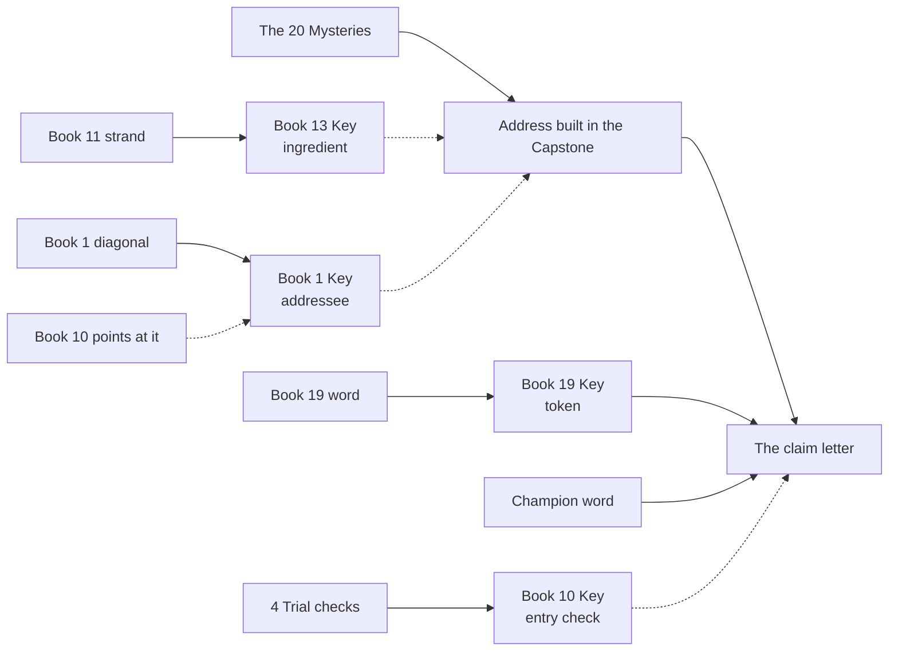
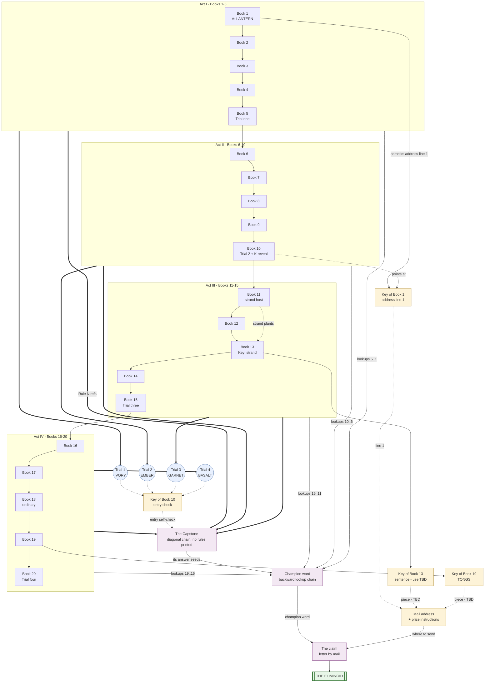

# Eliminoid series map (v0.2 — now with specifics)

Working plan for the whole series, written plainly, now with concrete
words and clues filled in. Anything marked [prov] is provisional: a
real, specific proposal that the engine must validate and that I may
swap for taste — but specific enough to hone. The wording of lore
messages (what the hidden sentences SAY) gets its own pass when the
storytelling voice exists; their shape and length are fixed here.

## What these books are

Each Eliminoid book is a book of word grids. You work through numbered
rules, crossing out words, and exactly one word in the whole book
survives everything. That's the answer; you write it in a box at the
back. Any book can be bought and solved on its own, in any order.

On top of that, a quest runs through the whole series. At its end, one
person wins the Eliminoid: a one-of-a-kind ceramic artwork I will
make. The books say all of this plainly, and make two promises:
nothing is hidden without a printed instruction somewhere that points
to it, and the whole quest can be done with the books alone.

The quest runs on a few simple ideas: dead words stay readable (cross
out with a thin line or highlighter, never obliterate); every word has
an address (page, row, column); each book from Book 2 on has a MYSTERY
WORD found via printed instructions, usually look-ups into earlier
books; each thing a book has you write down gets its own page and
its own box — the ANSWER on its page, the MYSTERY on its page, and in
the few books that grant one, the KEY on its page. These are the
pages of honour in the back of every book. A Key is a kept thing
that unlocks something later; at most one per book, and most books
have none, which makes the ones that do feel special. Nothing is
gathered in a central ledger — each value lives in the book it came
from, so a reference reads "Book 19's Key," and everything finally
comes together only at the Capstone. Beside every
written word — the Answer, the Mystery, a Trial word, a Key word —
sits a CHECKSUM: turn the letters into numbers (A=1...Z=26) and add
them, and the book tells you the total to expect. A mistake shows the
moment it happens, so nobody chases a wrong word through the rest of
the series. (A number Key like Book 10's carries its own stated
total.)

## Hiding things well (the camouflage laws)

A plant must be invisible to someone without the instruction and
unmistakable to someone with it. Four laws:

1. Never plant message words in adjacent cells. A row reading HOLD
   THESE UNTIL TRIAL THREE jumps out of a field of unconnectable
   words. Scatter instead: initials down a column, every-Nth
   positions, single words at far-apart addresses.
2. Prefer initials. A column of words like GRANITE, LENTIL, OTTER
   reads as nothing; its first letters can spell anything. Initials
   are the workhorse of hidden text.
3. Search bounds are a difficulty knob, not a requirement. An
   instruction may name a page range to make a hunt quick, or leave
   the whole book as the haystack when the hunt itself is meant to be
   work (Ian: "it's OK for the player to look through 100 pages of
   words"). What it must always do is name the BOOK — the search
   space is stated even when it is large. Exact addresses need no
   bounds.
4. Plants are cast to type. A word meant to be found later should look
   like any other grid word — commonish, unremarkable. No plant may be
   the strangest word on its page.
5. No artificial waiting. If a payoff is deferred to a later book, that
   book must be a necessary ingredient of the payoff — part of the
   path, not just the envelope the instruction arrives in. A reader
   should never be able to say "you could have told me this earlier."
6. Every revelation bears on the outcome. A hidden thing, once found,
   must be an INPUT to something downstream — never just a tease, a
   warning, or a description. If removing a revelation changes nothing
   about reaching the champion word, the revelation is decoration and
   must be redesigned or cut.
7. Hidden content must be self-sufficient. Hiding an instruction is
   fine — the strand's CROSS OUT EVERY SECOND WORD OF THE LAST GRID
   is one — but it must be complete and clear on its own, actionable
   with no supplemental explanation. The failure mode is a hidden
   thing the revealer must then paraphrase (then why was it hidden?).
   Pointers locate; they never restate.
8. Every Mystery must be load-bearing in the end game. A Mystery that
   was clever to derive but does nothing afterward is only half a
   mechanism. The finale must use each one individually — a wrong
   Mystery must break the ending — not merely pool them as
   interchangeable fodder. The mail-address concatenation (each
   Mystery donates one specified letter) is how this is met.
9. A Mystery depends only on earlier books. Book N's Mystery uses Book
   N itself and the books before it, never a later one — so any book
   is solvable the moment you own it and the ones under it. The
   Mysteries form a chain: each grows from the previous book's
   Mystery, back to Book 1's, which is derived from Book 1 alone.


## Shape of the series

Twenty books in four arcs of five. A Trial closes each arc (Books 5,
10, 15, 20), each yielding one recorded word. After Book 20 comes the
CAPSTONE, a simple diagonal: its chain is Rule 1 from Book 1 through
Rule 20 from Book 20, so the shelf is the rulebook. How it yields the
final champion word is still being designed; the claim will happen by
mail. Paper the whole way down.

All books have certain things in common. All have a page of rules that
eliminate words. All have a body, consisting of 100
pages of 5 columns and 25 rows of words. All have the answer box at the end, 
on its own page, 
where the player writes in the last-remaining word; we provide a checksum
of this word so the player can verify that they got it right.

All books have a page of hints counting how many words are eliminated by each rule,
which is flanked on either side by a "SPOILER ALERT" page so people know
that the hints are in there.

There is the cover and back blurb and all that kind of decoration.
In addition to those things, each book will have extra content that ties it
into the greater adventure -- a MYSTERY which is always just a single word, and
possibly a KEY which could be anything worth writing down as part of solving the
entire journey.

---

## How every Mystery is found

Every book's Mystery is found the same way — one procedure the reader
learns once and repeats for the rest of the series. It uses two things
you must have earned: the ANSWER you just solved for THIS book, and the
MYSTERY Word from the book before.

  "Take your answer for this book. Turn its letters into numbers
  (A=1, B=2...) and add them up — that is a page in this book. Now
  take your Mystery Word from the book before: its letter count is
  the row, its vowel count is the column. Go to that spot in this
  book. The word there is your Mystery Word."

Because the page comes from the answer, you must have SOLVED this book
to find its Mystery — owning it is not enough. And because the row and
column come from the previous Mystery, you must have walked the chain.
Each link needs the one before, so the run reaches all the way back to
Book 1 — the only book that makes its Mystery from its own answer
alone (it has no previous Mystery, so it uses its answer for the row
and column too). Having Book N's Mystery proves you solved Books 1
through N (law 9).

```pseudocode
CHECKSUM(word)   = { add letter scores A=1, B=2, ...; return a number }
LENGTH(word)     = { return the number of letters }
VOWELCOUNT(word) = { return the number of vowels }
LOOKUP(book, pos) = { return the word printed at pos }

Mystery[N] = LOOKUP( book[N], {
  page:   CHECKSUM(Answer[N]),       // you solved book N
  row:    LENGTH(Mystery[N-1]),      // you walked the chain
  column: VOWELCOUNT(Mystery[N-1])
} )
// Book 1: no previous Mystery, so row/column use Answer[1].
```

The Mysteries are deliberately plain and uniform. The clever, varied
challenges live in the KEYS (see "The Keys" below) — the rare,
special clues that build toward the prize.

## Book by book

### Books 1-5

**Book 1.** The root of the chain. It has no previous Mystery, so it
uses its answer for all three numbers:

  "Take your answer. Turn its letters into numbers (A=1, B=2...) and
  add them up — that is a page. Its letter count is the row, its
  vowel count the column. Go to that spot in this book. The word
  there is your Mystery Word."

[prov] With the answer LANTERN: 84, seven letters, two vowels — page
84, row 7, column 2, holding [prov] CINDER (checksum 53). Every later
Mystery grows out of this one.

Book 1 also carries, dormant until later books point at them:

- Its KEY: a diagonal acrostic. On page 12, reading one word per row
  and stepping one column to the right each row (wrapping back to the
  left when it runs off the edge), the first letters of the 25 words
  spell TO THE KEEPER OF THE ELIMINOID (25 letters) — the first line
  of the address you mail the prize to. A staircase, not a column, so
  it is far harder to spot. The KEY box sits empty with an IOU until
  Book 10 shows you where to read it.
- Book 2's Mystery word, planted here (Book 2's search reads it).
- Five Trial-one targets (see Book 5). (Any stencil/acrostic plant for a future Key is set when that Key is designed.)

Book 1's [prov] answer: LANTERN — chosen so its own arithmetic lands
on a real spot in Book 1.

**Book 2.** The standard procedure begins (see "How every Mystery is
found"): the answer you solved for Book 2 gives the page; Book 1's
Mystery gives the row and column; read that spot in Book 2. [prov]
Mystery: VESSEL. The page teaches the procedure plainly, since every
later book repeats it.

```pseudocode
Mystery[book2] = LOOKUP(book2, {
  page: CHECKSUM(Answer[book2]), row: LENGTH(Mystery[book1]),
  column: VOWELCOUNT(Mystery[book1])
})   // VESSEL
```

**Book 3.** Same procedure, now using Book 3's answer and Book 2's
Mystery. [prov] Mystery: TBD. By the third book the chain feels like a
chain — each new Mystery needs the last.

```pseudocode
Mystery[book3] = LOOKUP(book3, {
  page: CHECKSUM(Answer[book3]), row: LENGTH(Mystery[book2]),
  column: VOWELCOUNT(Mystery[book2])
})
```

**Book 4.** Standard procedure (points at Book 3). [prov] Mystery:
TBD.

```pseudocode
Mystery[book4] = LOOKUP(book4, {
  page: CHECKSUM(Answer[book4]), row: LENGTH(Mystery[book3]),
  column: VOWELCOUNT(Mystery[book3])
})
```

**Book 5. Trial one.** The Mystery is the standard procedure (points
at Book 4). On top of that, the first TRIAL: a printed empty 5x5
grid, each cell labelled with an address — five per book across Books
1-5, in a compact notation taught on the page ("B3 62:14:2 means Book
3, page 62, row 14, column 2"). Fill all 25 by look-up.

All twenty-five candidate words share the same checksum — a small
joke, and the reason you cannot pick the winner by adding up letters:
the hint matches every word, so you have to actually work the rules.
Apply the four mini-rules printed beneath ([prov] style: "cross out
every word with a double letter"; "...of five or fewer letters";
"...containing the letter A"; "...ending in a consonant") until one
word stands — your Trial word.

The check is not the Trial word's checksum alone (that would just be
the shared number). The book asks for a combined total: add the
checksums of your Trial word, this book's Answer, and this book's
Mystery; the total should be the printed number. So verifying the
Trial needs the book you solved and the chain you walked, not just
the look-ups. (Trial books carry two boxes: the Trial word and the
ordinary Mystery.)

```pseudocode
MINI_SOLVE(wordset, minirules) = { apply each rule; return the survivor }

Mystery[book5] = LOOKUP(book5, {
  page: CHECKSUM(Answer[book5]), row: LENGTH(Mystery[book4]),
  column: VOWELCOUNT(Mystery[book4])
})
Trial[1] = MINI_SOLVE([ 25 looked-up words, all sharing checksum C ], minirules)
TrialCheck[1] = CHECKSUM(Trial[1]) + CHECKSUM(Answer[book5]) + CHECKSUM(Mystery[book5])
                // = C + cs(answer) + cs(mystery); printed beside the box
```

(Trials two, three, and four work the same way — their 25 candidates
each share a checksum, and each Trial's check folds in that book's
Answer and Mystery.)

### Books 6-10

**Book 6.** Standard procedure (points at Book 5). [prov] Mystery:
TBD.

```pseudocode
Mystery[book6] = LOOKUP(book6, {
  page: CHECKSUM(Answer[book6]), row: LENGTH(Mystery[book5]),
  column: VOWELCOUNT(Mystery[book5])
})
```

**Book 7.** Standard procedure (points at Book 6). [prov] Mystery:
TBD.

```pseudocode
Mystery[book7] = LOOKUP(book7, {
  page: CHECKSUM(Answer[book7]), row: LENGTH(Mystery[book6]),
  column: VOWELCOUNT(Mystery[book6])
})
```

**Book 8.** Standard procedure (points at Book 7). [prov] Mystery:
TBD.

```pseudocode
Mystery[book8] = LOOKUP(book8, {
  page: CHECKSUM(Answer[book8]), row: LENGTH(Mystery[book7]),
  column: VOWELCOUNT(Mystery[book7])
})
```

**Book 9.** Standard procedure (points at Book 8). [prov] Mystery:
TBD.

```pseudocode
Mystery[book9] = LOOKUP(book9, {
  page: CHECKSUM(Answer[book9]), row: LENGTH(Mystery[book8]),
  column: VOWELCOUNT(Mystery[book8])
})
```

**Book 10. Trial two.** Mystery is the standard procedure (points at
Book 9). Plus the second TRIAL (25 addresses across Books 6-10; [prov]
Trial word: EMBER, checksum 43). And a reveal that unlocks Book 1's
KEY:

  "Book 1 has carried a secret since the day it was printed. Page 12,
  start at the top-left word. Take its first letter. Move down one
  row and one column to the right, and take that word's first letter.
  Keep going — down one, right one — and when you run off the right
  edge, come back to the left column. Twenty-five rows, twenty-five
  letters. Write what they spell in BOOK 1's KEY box. You will not
  learn what it is for until the last volume."

Book 10 cannot restate the line — its only home is Book 1's column
(law 7). It is TO THE KEEPER OF THE ELIMINOID.

Book 10 also opens its own KEY in plain print (bookkeeping, no
hiding): "Each Trial gives you a check number. When you have all four
(after Book 20), add those four numbers and write the total in THIS
book's KEY box." ([prov] total.) The Capstone asks for it as the
entry self-check.

```pseudocode
Mystery[book10] = LOOKUP(book10, {
  page: CHECKSUM(Answer[book10]), row: LENGTH(Mystery[book9]),
  column: VOWELCOUNT(Mystery[book9])
})
Trial[2] = MINI_SOLVE([ 25 looked-up words, all sharing checksum C ], minirules)
TrialCheck[2] = CHECKSUM(Trial[2]) + CHECKSUM(Answer[book10]) + CHECKSUM(Mystery[book10])

DIAGONAL(book, page) = {
  for r in 0..24: take the word at (row r+1, column ((r) mod 5)+1)
  return the sequence of words
}
Key[book1]  = SPELL(INITIALS(DIAGONAL(book1, page[12])))
              // TO THE KEEPER OF THE ELIMINOID -- address line 1
Key[book10] = TrialCheck[1] + TrialCheck[2]
            + TrialCheck[3] + TrialCheck[4]   // [prov] total, after Book 20
```

### Books 11-15

**Book 11.** Standard procedure (points at Book 10). [prov] Mystery:
TBD. It also quietly carries the strand plants in its grid (Book 13
reads them — see its Key).

```pseudocode
Mystery[book11] = LOOKUP(book11, {
  page: CHECKSUM(Answer[book11]), row: LENGTH(Mystery[book10]),
  column: VOWELCOUNT(Mystery[book10])
})
```

**Book 12.** Standard procedure (points at Book 11). [prov] Mystery:
TBD.

```pseudocode
Mystery[book12] = LOOKUP(book12, {
  page: CHECKSUM(Answer[book12]), row: LENGTH(Mystery[book11]),
  column: VOWELCOUNT(Mystery[book11])
})
```

**Book 13.** Standard procedure for the Mystery (points at Book 12).
Its KEY is the series' first clever clue — a strand of hidden letters:

  "In Book 11, pages 20 through 24, read every 17th word — crossed
  out or not — and write down their first letters."

Thirty-six words, so thirty-six letters [prov]: a sentence, written
in this book's KEY box. (Many of those words are crossed out by now —
this is the readable-dead rule paying rent.) The sentence is one of
the ingredients the Capstone's address recipe draws on.

```pseudocode
Mystery[book13] = LOOKUP(book13, {
  page: CHECKSUM(Answer[book13]), row: LENGTH(Mystery[book12]),
  column: VOWELCOUNT(Mystery[book12])
})
Key[book13] = SPELL(INITIALS( EVERY_NTH(GET_WORDS(book11, pages[20..24]), 17) ))
              // [prov] sentence; an address-recipe ingredient
```

**Book 14.** Standard procedure (points at Book 13). [prov] Mystery:
TBD.

```pseudocode
Mystery[book14] = LOOKUP(book14, {
  page: CHECKSUM(Answer[book14]), row: LENGTH(Mystery[book13]),
  column: VOWELCOUNT(Mystery[book13])
})
```

**Book 15. Trial three.** Mystery is the standard procedure (points
at Book 14). Plus the third TRIAL (25 addresses across Books 11-15;
[prov] Trial word: GARNET, checksum 65).

```pseudocode
Mystery[book15] = LOOKUP(book15, {
  page: CHECKSUM(Answer[book15]), row: LENGTH(Mystery[book14]),
  column: VOWELCOUNT(Mystery[book14])
})
Trial[3] = MINI_SOLVE([ 25 looked-up words, all sharing checksum C ], minirules)
TrialCheck[3] = CHECKSUM(Trial[3]) + CHECKSUM(Answer[book15]) + CHECKSUM(Mystery[book15])
```

### Books 16-20

**Book 16.** Standard procedure (points at Book 15). [prov] Mystery:
TBD.

```pseudocode
Mystery[book16] = LOOKUP(book16, {
  page: CHECKSUM(Answer[book16]), row: LENGTH(Mystery[book15]),
  column: VOWELCOUNT(Mystery[book15])
})
```

**Book 17.** Standard procedure (points at Book 16). [prov] Mystery:
TBD.

```pseudocode
Mystery[book17] = LOOKUP(book17, {
  page: CHECKSUM(Answer[book17]), row: LENGTH(Mystery[book16]),
  column: VOWELCOUNT(Mystery[book16])
})
```

**Book 18.** Standard procedure (points at Book 17). [prov] Mystery:
TBD.

```pseudocode
Mystery[book18] = LOOKUP(book18, {
  page: CHECKSUM(Answer[book18]), row: LENGTH(Mystery[book17]),
  column: VOWELCOUNT(Mystery[book17])
})
```

**Book 19.** Standard procedure for the Mystery (points at Book 18).
Its KEY is one extra word the reader is told to keep: [prov] TONGS,
with the note "write this in this book's KEY box; the last volume
needs it." It is the token the reader encloses in the claim letter,
a second proof beside the champion word.

```pseudocode
Mystery[book19] = LOOKUP(book19, {
  page: CHECKSUM(Answer[book19]), row: LENGTH(Mystery[book18]),
  column: VOWELCOUNT(Mystery[book18])
})
Key[book19] = TONGS   // [prov] the enclosed claim token
```

**Book 20. Trial four, and the gate.** Mystery is the standard
procedure (points at Book 19). Plus the fourth TRIAL ([prov] word:
BASALT, checksum 55). Then the printed pages, in order:

  "You have now done all four Trials — Books 5, 10, 15, and this one.
  Book 10 told you this day would come. Each Trial gave you a check
  number. Add those four numbers together and write the total in BOOK
  10's KEY box. The last volume will ask you for it."

  "There is one more book — the Capstone. It has no rules of its own.
  It needs all the others. It is the end of the journey. You can buy
  it wherever you bought this one."

```pseudocode
Mystery[book20] = LOOKUP(book20, {
  page: CHECKSUM(Answer[book20]), row: LENGTH(Mystery[book19]),
  column: VOWELCOUNT(Mystery[book19])
})
Trial[4] = MINI_SOLVE([ 25 looked-up words, all sharing checksum C ], minirules)
TrialCheck[4] = CHECKSUM(Trial[4]) + CHECKSUM(Answer[book20]) + CHECKSUM(Mystery[book20])
Key[book10] = TrialCheck[1..4] summed   // [prov] total, completed here
```

## The Keys

A few books carry a KEY — a special clue, written in its own box, that
the reader keeps toward the very end. Where the Mysteries are plain and
uniform, the Keys are where the cleverness lives: each uses whatever
trick suits it. Between them, the Keys spell out where to mail the
prize claim and what to put in the letter. (The champion word, proof
of solving the whole series, comes from the Capstone — see below.)

The toolkit of tricks a Key may use:

- ACROSTIC — first letters of a column, a wrapping diagonal, or a
  scattered strand spell a message.
- COUNTS — arithmetic on the per-rule elimination counts (the table at
  the back of every book).
- WEAVE — interleave a row from two books, then read the result.
- BORROWED RULE — apply one book's elimination rule to words grabbed
  from another book.
- STENCIL — a printed silhouette of marked cells laid over an earlier
  page.
- RIFFLE / SHUFFLE, and others to invent.

The Keys, and what each one holds [all prov]:

- **Book 1 — the addressee.** DIAGONAL ACROSTIC: on page 12, one word
  per row stepping one column right each row (wrapping at the edge),
  the first letters spell TO THE KEEPER OF THE ELIMINOID. The KEY box
  waits with an IOU until Book 10 points at it. The Capstone prints
  the Keeper's name plainly, so this Key is the reader's proof they
  found it — and a day-one secret for its own sake.
- **Book 13 — a construction ingredient.** ACROSTIC strand: every 17th
  word in Book 11, pages 20-24, first letters — a [prov] sentence,
  read partly from crossed-out words. The Capstone's address recipe
  draws on it.
- **Book 19 — the token.** A single word, [prov] TONGS, you are told
  to keep; it goes inside the claim letter as a second proof beside
  the champion word.
- **Book 10 — the entry check.** The four Trial check numbers added
  ([prov] total). Not part of the address — the self-check the
  Capstone asks for before you begin the end.

The real work of the address happens in the Capstone, which builds
the hidden location character by character from the twenty Mysteries
(see "The Capstone"). The Keys are the special, hand-made clues along
the way; the Mysteries are what the final address is spelled from.

How the Keys and the Mysteries reach the claim:



Each Key's clue is printed in full, self-contained, in the book that
carries it (law 7); Book 1's is the only one pointed at from
elsewhere, because its box has to wait for the reader to be ready.

### The Capstone

The book with no rules. The Capstone prints not one elimination rule
of its own: everything operative is gathered
from the rest of the series or from the reader's own ink. What it
does print: the entry self-check, the diagonal manifest, its grid,
the boxes, the address-construction recipe, and the claim directions. Its cover states plainly
that it cannot be solved without the other twenty books.

The chain is the simple diagonal: the manifest's first
twenty lines just say "Rule 1 is Book 1's Rule 1. Rule 2 is Book 2's
Rule 2. ..." The shelf is the rulebook — reading each rule means
opening each book.

The finale has two parts, and together they use every book twice
over.

The CHAMPION WORD — what you mail as proof you did the whole series —
is a chain of look-ups running backward through all twenty books.
Solving the diagonal gives you the Capstone's own answer, but that is
only the start: you take that word, turn its letters into numbers to
get a page, row, and column (the usual way), and look up that spot in
BOOK 19. That gives a new word. You do the same with it in BOOK 18.
Then Book 17, Book 16, all the way back to Book 1. The word you land
on in Book 1 is the champion. You cannot reach it without every book
on the shelf — finishing the Capstone alone is nowhere near enough.
[prov]: TBD (the word the chain lands on, chosen at build).

The ADDRESS — where you mail it — is built right here, in a section
of the Capstone devoted to it, out of the Mystery words you collected
across the whole series. The Keeper's name is printed plainly; the
LOCATION is not. A recipe constructs it one character at a time,
each drawn by a small trick from a Mystery you earned:

  "Postal code, first letter: the first letter of your Book 3
  Mystery. Second character: the number of letters in your Book 7
  Mystery. Third: the first letter of your Book 11 Mystery. ..."
  — and on through the box number, the town, and the region.

Letters come from first letters of Mysteries; digits come from the
length of a Mystery, or the last figure of a page a Mystery sits on.
Every one of your twenty Mysteries donates at least one character, so
the address is the true reward for having chased them all: one wrong
Mystery is one wrong character, and the letter goes nowhere. The
engine picks which Mystery feeds which character at build, so the
real address falls out exactly.

So: solve the diagonal and run the champion word back through all
twenty books; build the address in the Capstone from your twenty
Mysteries; enclose the champion word and your Book 19 token; mail it. The address is a PO box I open before the
series is finished and keep for as long as the quest runs; the books
also print "or wherever eliminoid.com says to write," in case a
decade outlasts the box.

A right word in the mail isn't proof on its own — words leak. So I
check the winner the only way that can't be faked: I ask them things
only a real solver would have in their books. The first honest
letter, by postmark, wins. Then the Eliminoid goes to them in the
mail, insured, packed by the person who made it. No digging, nothing
buried — I just send it.

The same day, I publish the document I wrote and locked before Book 1
ever went on sale — I'd posted its fingerprint back then so anyone
could check it hadn't changed. It shows the whole thing was planned
from the start.

```pseudocode
// Champion word: a backward chain through every book.
w = ANSWER(capstone)                 // seed: the diagonal's survivor
for b in [19, 18, 17, ..., 2, 1]:    // back to the beginning
  w = LOOKUP(book[b], {
        page:   CHECKSUM(w),
        row:    LENGTH(w),
        column: VOWELCOUNT(w)
      })
Champion = w                         // the word it lands on in Book 1

// Address: every Mystery load-bearing, one letter each.
NTH_LETTER(word, n) = { return letter at position n }
line2 = concat(
  [ NTH_LETTER(Mystery[b], pos[b]) for b in 1..20 ]
  + [ NTH_LETTER(Answer[b], ...) for a few b, where needed ]
)   // pos[] printed in the Capstone recipe, chosen at build so line2
    // spells "POBOXFOURONESEVEN<CITY>"
Address = Key[book1] + newline + line2
```

You buy the Capstone like any other book. It sits on the shelf for
sale next to the rest. The only difference is its cover says plainly
that you can't solve it without the other twenty — same honesty as
everything else in the series.

---


## The connection graph

How everything feeds everything. Solid arrows: "this book's printed
grid is an ingredient." Dashed arrows: "this earlier found VALUE is an
ingredient." Renders on GitHub and in VS Code's Mermaid preview.



Reading the graph: Book 1 has the highest out-degree (seven edges — the
quarry, as designed); every Mystery has at least one inbound book edge
(no self-contained oddballs except B6/B9/B12, whose edges are internal
arithmetic); the Mysteries form one straight chain back to Book 1; the champion is
a backward chain touching every book; the address and prize
instructions come from the Keys. If an edge is missing here, it is
missing in the design.

## Builder notes

The technical section. Every plant is machine-validated at series
build; every secret must appear in the revealer ledger.

The Mystery chain (the backbone):
- For every book N, the Mystery cell is { page CHECKSUM(Answer[N]),
  row LENGTH(Mystery[N-1]), column VOWELCOUNT(Mystery[N-1]) } in book
  N — so the page comes from THIS book's answer (you solved it) and
  the row/column from the previous Mystery (you walked the chain).
  Book 1 uses its own answer for all three.
- The builder picks each book's Answer and the Mystery word at that
  cell: Answer[N]'s checksum must be a real page (<=100), and the
  chosen Mystery word must sit legally at the computed cell. One
  solvable constraint chain across all 20 books; the engine proves it.
- Every Answer and every Mystery gets a printed checksum — and since
  the derivation itself runs on the answer's checksum, a reader who
  mis-sums is caught by the same arithmetic twice.
- Security property (the point): the Mystery chain cannot be run from
  Book 1's Mystery alone. Each step needs that book's Answer, which
  needs solving that book. Knowing an early Mystery buys nothing
  without doing every book's puzzle.

Trials:
- Five Trial targets planted per book in each arc; Books 5/10/15/20
  print the Trial grid + four mini-rules. Each Trial's 25 candidates
  are chosen to share one checksum C (pick a C with >=25 dictionary
  words; assign mini-rules that leave exactly one). The printed check
  = C + the book's answer checksum + its mystery checksum. [prov]
  survivors IVORY, EMBER, GARNET, BASALT. Trial books carry two boxes
  (Trial + Mystery).

Keys (the clever clues):
- Book 1: wrapping-diagonal acrostic on p12 (step +1 column per row,
  mod 5) = TO THE KEEPER OF THE ELIMINOID; 25 constrained initials;
  KEY box with an IOU until Book 10 points at it.
- Book 13: strand = every-17th initials in Book 11 pp20-24, a [prov]
  sentence (readable-dead); an address-recipe ingredient.
- Book 19: planted token [prov] TONGS, enclosed in the claim letter.
- Book 10: the four Trial checks summed ([prov] total); the Capstone
  entry self-check.

Address construction (in the Capstone):
- The hidden location (box number, town, region, postal code) is
  built character by character from the 20 Mysteries: letters from
  Mystery first-letters, digits from Mystery lengths or the last
  figure of a page a Mystery sits on. The builder assigns which
  Mystery feeds which character so the real address resolves, and
  every Mystery feeds at least one character.

Champion word:
- A backward look-up chain seeded by the Capstone's answer, back
  through Books 19..1, landing on a [prov] word in Book 1; the builder
  plants the chain so it resolves. Requires the whole shelf.

Capstone:
- The diagonal chain (Book N's Rule N for N=1..20), keep_fractions
  retuned by the Advisor to a buildable, verifiable chain; its
  survivor seeds the champion chain.

Revealer ledger (no secret without its pointer):
- Book 1's Mystery -> self-sufficient. Every other Mystery -> the
  standard procedure printed in that book (points one book back).
- Book 1's acrostic/Key -> IOU box, pointed at by Book 10, never
  restated; the addressee line (the Capstone prints the Keeper's name
  plainly too, so this Key is the reader's own confirmation).
- Book 13's Key (strand) -> its own instruction in Book 13; an
  address-recipe ingredient.
- Book 19's Key (TONGS) -> named plainly in Book 19; the enclosed
  claim token.
- The address location -> built in the Capstone from the 20
  Mysteries (recipe printed there).
- Book 10's Key (Trial-check total) -> instructed plainly in Book 10, completed at
  Book 20, consumed by the Capstone entry check.
- The Capstone -> announced in Book 20.

Answer-selection constraints: Book 1's answer passes the self-lookup
arithmetic (coords land in bounds in Book 1); every answer survives
its own book's chain; every [prov] word exists in the typeset
dictionary and sits legally at its host cell. The engine proves all
of it before anything prints.

All 21 volumes built, cross-validated against this map, and hashed
before Book 1 goes on sale.


---

## Summary: Answers, Mysteries, Keys

Every book has an **Answer** (the word left standing after the main
puzzle) and a **Mystery** (found after the Answer). From Book 2 on,
the Mystery is always the same procedure: this book's answer gives a
page, the previous book's Mystery gives the row and column, and you
read that spot in this book. Book 1 uses its own answer for all three.
So each Mystery needs both this book's answer (solved) and the chain,
and both the Answer and the Mystery carry a checksum hint.

A **Key** appears only in some books — a special, clever clue written
down and carried toward the prize. The Keys, between them, reveal the
mailing address and the claim instructions.

All words are [prov].

- **Book 1** — answer LANTERN; Mystery CINDER (its answer's letters
  point to a spot in Book 1). Key: TO THE KEEPER OF THE ELIMINOID —
  first letters of a wrapping diagonal on page 12, the first line of
  the address.
- **Book 2** — Mystery VESSEL (standard procedure, back to Book 1).
- **Book 3** — Mystery (standard, back to Book 2).
- **Book 4** — Mystery (standard, back to Book 3).
- **Book 5** — Mystery (standard, back to Book 4). Trial one: IVORY.
- **Book 6** — Mystery (standard, back to Book 5).
- **Book 7** — Mystery (standard, back to Book 6).
- **Book 8** — Mystery (standard, back to Book 7).
- **Book 9** — Mystery (standard, back to Book 8).
- **Book 10** — Mystery (standard, back to Book 9). Trial two: EMBER.
  Reveals Book 1's Key. Key: the four Trial checks summed [prov].
- **Book 11** — Mystery (standard, back to Book 10). Hosts Book 13's
  strand plants.
- **Book 12** — Mystery (standard, back to Book 11).
- **Book 13** — Mystery (standard, back to Book 12). Key: a [prov]
  sentence from every 17th word in Book 11 (read partly from
  crossed-out words), an ingredient the Capstone's address uses.
- **Book 14** — Mystery (standard, back to Book 13).
- **Book 15** — Mystery (standard, back to Book 14). Trial three: GARNET.
- **Book 16** — Mystery (standard, back to Book 15).
- **Book 17** — Mystery (standard, back to Book 16).
- **Book 18** — Mystery (standard, back to Book 17).
- **Book 19** — Mystery (standard, back to Book 18). Key: TONGS
  [prov], the token enclosed in the claim letter.
- **Book 20** — Mystery (standard, back to Book 19). Trial four: BASALT.
- **Capstone** — answer seeds the champion chain: looked up back
  through Books 19, 18, ... 1. The word it lands on in Book 1 is the
  champion — what you mail.

Keys: Book 1 (addressee), Book 13 (a construction ingredient), Book 19
(enclosed token), Book 10 (entry check). The hidden LOCATION (box,
town, region, postal code) is built in the Capstone from the twenty
Mysteries, so every Mystery feeds the final address. Still open: the
exact [prov] words and numbers, chosen at build.

Trial words [prov]: IVORY, EMBER, GARNET, BASALT. Each Trial's 25
candidate words share one checksum (so the winner can't be picked by
checksum), and each Trial's check number folds in that book's Answer
and Mystery. Book 10's Key is the four check numbers summed [prov].
